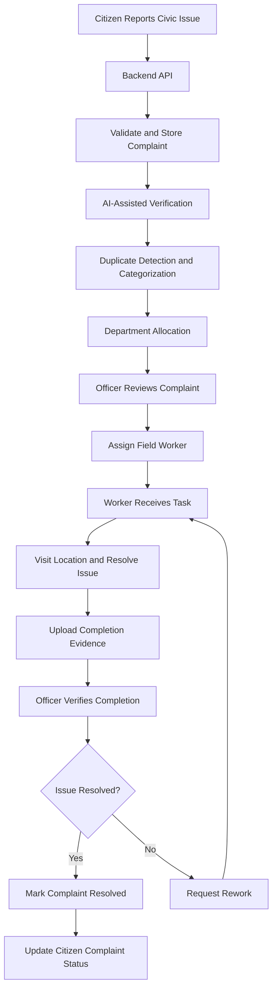
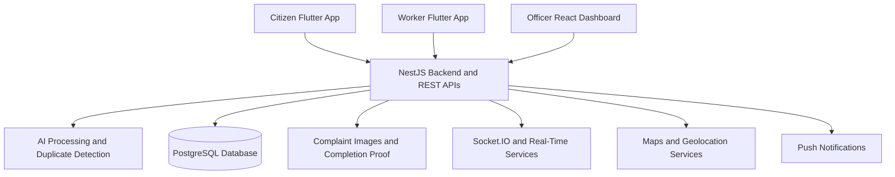

# My City Connect
### AI-Assisted Civic Issue Management and Resolution Platform

**One Platform. Three Stakeholders. From Complaint to Verified Resolution.**

## 1. Project Overview

My City Connect is an integrated civic issue management platform designed to improve how citizens report public infrastructure problems and how municipal authorities manage, assign, track, and resolve them.

The platform connects three major stakeholders through a common backend:

- **Citizens** report civic issues and track complaint progress.
- **Government Officers** monitor complaints, manage departments, identify problem hotspots, and assign workers.
- **Field Workers** receive assigned tasks, navigate to complaint locations, update task progress, and submit completion evidence.

The system combines mobile applications, a web dashboard, GPS-based location services, AI-assisted complaint processing, real-time communication, and a centralized database to support a transparent complaint lifecycle.

## 2. Problem Statement

Traditional civic complaint management can face several challenges:

- Citizens may find it difficult to report issues and follow up on their complaints.
- Duplicate, incomplete, or questionable reports can increase the workload of municipal authorities.
- Manual complaint allocation can delay action by the appropriate department.
- Officers may lack a unified view of complaint locations, worker assignments, and progress.
- Citizens may not receive clear updates about complaint resolution.
- Reported completion may require additional verification to establish whether the issue has actually been addressed.

My City Connect aims to address these challenges through a unified digital workflow connecting reporting, verification, assignment, field execution, and resolution review.

## 3. Objectives

- Simplify civic issue reporting through a citizen-friendly mobile application.
- Support AI-assisted complaint verification and categorization.
- Identify potential duplicate complaints.
- Route complaints to the appropriate municipal department.
- Enable officers to assign and monitor field workers.
- Provide location-based complaint visualization and hotspot monitoring.
- Allow citizens to track complaint status.
- Support evidence-based completion review and rework when necessary.
- Improve transparency, coordination, and accountability in civic services.

## 4. Major Modules

### 4.1 Citizen Mobile Application

The Citizen App provides the public interface for reporting and monitoring civic issues.

**Key features:**

- Citizen registration and login.
- Civic issue reporting with category and description.
- Photo capture and image upload.
- GPS-based complaint location.
- Text and voice input options where supported.
- AI-assisted verification and complaint categorization.
- Potential duplicate complaint detection.
- Complaint priority and status display.
- Complaint history and detailed complaint tracking.
- Alerts and notifications where configured.
- Profile, language, and privacy settings.
- Feedback submission.

**Example:** A citizen notices a pothole, captures its photograph, adds the issue description, and submits the complaint with its location. The system processes the report and makes its status available through the application.

### 4.2 Officer Web Dashboard

The Officer Dashboard provides municipal authorities with a centralized interface for complaint management and field operations.

**Key features:**

- Officer authentication.
- Operations command center.
- Complaint list and complaint details.
- Complaint status and priority monitoring.
- Live map visualization.
- Complaint hotspot and red-zone monitoring.
- Department and unit management.
- Worker management.
- Complaint-to-worker assignment.
- Analytics and operational summaries.
- Notification management.
- Complaint completion review.
- Approval or rework workflows, where configured.

**Example:** An officer reviews a high-priority pothole complaint, checks its location, selects the appropriate department, and assigns a worker to address the issue.

### 4.3 Worker Mobile Application

The Worker App supports field execution and task progress reporting.

**Key features:**

- Worker registration or login, according to the configured workflow.
- Worker profile and availability.
- Assigned task list.
- Task details, category, priority, and location.
- GPS and map-based navigation.
- Task status updates.
- Live location and tracking features where enabled.
- Completion photograph capture.
- GPS information associated with completion evidence where configured.
- Completion notes and remarks.
- Submission of completion proof.
- Notifications and task updates.

**Example:** A worker receives an assigned streetlight repair task, travels to the specified location, performs the work, and submits a completion photograph with the relevant task details.

## 5. Complete System Workflow

The platform follows a complaint lifecycle involving citizens, AI-assisted processing, officers, and workers.

### Step 1: Citizen Reports an Issue

The citizen logs in to the mobile application and submits a civic complaint containing relevant details such as:

- Issue category.
- Description.
- Photograph or other supported evidence.
- GPS coordinates or complaint location.
- Optional text or voice input, where supported.

### Step 2: Backend Receives the Complaint

The backend receives the request through the relevant REST API, validates the supplied information, and manages complaint creation.

The complaint is associated with its submitter and the available issue details. Its lifecycle status is maintained in the application database.

### Step 3: AI-Assisted Verification

The AI processing module evaluates the submitted complaint using the verification capabilities configured in the backend.

The intended checks include:

- Assessing whether the image is relevant to the reported civic issue.
- Categorizing the complaint.
- Identifying potentially duplicate complaints.
- Producing or using a confidence score where supported.
- Flagging uncertain reports for further review.

AI output supports the decision-making process. Uncertain results should not automatically be treated as proof that a complaint is fake.

### Step 4: Department Allocation

The complaint category is used to determine the appropriate municipal department.

For example:

- Potholes and damaged roads → Roads or Public Works Department.
- Broken streetlights → Electrical Department.
- Garbage accumulation → Sanitation Department.
- Water leakage → Water Supply Department.

The actual department mapping depends on the configured department registry and allocation logic.

### Step 5: Officer Reviews and Assigns a Worker

The officer views complaint details and location information through the web dashboard.

The officer can review priority, department, worker availability, and other relevant information before assigning the task according to the available workflow.

### Step 6: Worker Receives the Task

The assigned worker accesses the task through the Worker App.

The worker reviews the issue, checks the complaint location, and proceeds to the site. The application supports task progress updates and relevant location-based functionality.

### Step 7: Worker Resolves the Issue

The worker performs the required maintenance or corrective action and updates the task status.

The worker then submits completion evidence, such as a photograph and completion notes.

### Step 8: Completion Verification

The completion evidence is made available for review through the configured workflow.

The officer can review the submitted proof and:

- Approve the completion.
- Request rework if the issue remains unresolved.
- Update the complaint's lifecycle status according to the review outcome.

### Step 9: Citizen Receives Status Updates

The complaint status progresses through the configured lifecycle, allowing the citizen to follow the issue from submission through assignment and resolution.

Notifications and real-time updates depend on the relevant services being configured and operational.

### Step 10: Reporting and Continuous Improvement

Complaint records, status changes, and available operational data can support dashboard summaries and analytics.

These insights can help authorities identify recurring issues, understand complaint hotspots, and plan resource allocation.

## 6. Workflow Diagram



This diagram represents the intended end-to-end workflow. The exact transitions and automatic actions depend on the implemented backend services and configuration.

## 7. System Architecture

My City Connect follows a modular client-server architecture.

### Presentation Layer

- Citizen Mobile App.
- Worker Mobile App.
- Officer Web Dashboard.

### Application Layer

The NestJS backend provides the shared application services used by the three modules.

These services cover:

- Authentication and authorization.
- Complaint management.
- AI-related processing.
- Duplicate detection.
- Department management.
- Worker management and assignments.
- Notifications.
- Tracking and real-time communication.
- Feedback and other supporting modules.

### Data Layer

PostgreSQL, accessed through Prisma ORM, serves as the primary structured database.

The database manages application records such as users, complaints, departments, assignments, statuses, and related information according to the Prisma schema.

File storage is handled through the configured upload mechanism. Local storage is supported, while AWS S3 is an available option where configured.

### Architecture Diagram



## 8. Technologies Used

### Mobile Applications

- **Flutter:** Cross-platform mobile application framework.
- **Dart:** Programming language for Flutter.
- **Riverpod:** State management in the Citizen App.
- **Dio / HTTP:** Communication with backend APIs.
- **Secure Storage / Shared Preferences:** Storage of supported local preferences and authentication-related data.
- **Camera and Image Picker:** Image capture and selection.
- **Geolocation and Geocoding:** Location retrieval and address conversion.
- **Google Maps:** Map-based location functionality where configured.
- **Firebase Messaging:** Push notifications where configured.

### Officer Web Dashboard

- **React 19:** User interface development.
- **TypeScript:** Type-safe application development.
- **Vite:** Development server and build tooling.
- **Tailwind CSS:** Styling and responsive layouts.
- **Lucide:** Interface icons.
- **Recharts:** Charts and data visualizations.
- **Motion:** UI animations where used.
- **Leaflet and OpenStreetMap:** Map visualization.
- **Socket.IO Client:** Real-time communication where configured.

### Backend

- **Node.js:** JavaScript runtime.
- **TypeScript:** Backend programming language.
- **NestJS 10:** Modular backend framework.
- **REST APIs:** Communication between the clients and backend.
- **Swagger:** API documentation where configured.
- **Passport.js and JWT:** Authentication components.
- **Class Validator and Class Transformer:** Request validation and transformation where configured.
- **Socket.IO:** Real-time communication and tracking support.

### Database and Storage

- **PostgreSQL:** Primary relational database.
- **Prisma ORM:** Database access and schema management.
- **Local File Storage:** Supported option for uploaded images and evidence.
- **AWS S3:** Optional storage integration.
- **MongoDB:** Optional for supporting AI audit or chatbot data if integrated.

### AI and Intelligent Processing

- AI-assisted image verification.
- Duplicate complaint detection.
- Complaint categorization.
- Confidence-based review where supported.
- Complaint prioritization logic.
- Chatbot functionality where configured.
- GPS and metadata consistency checks where implemented.

**Algorithm note:** The exact trained model, AI provider, and similarity algorithm must be identified from the actual backend implementation. CNN, MobileNetV2, EfficientNet, NLP classifiers, and cosine similarity should not be claimed as implemented unless the source code confirms their use.

## 9. Complaint Status Lifecycle

The backend's complaint status model includes the following lifecycle states:

| Status | Meaning |
|---|---|
| `SUBMITTED` | Complaint submitted by the citizen. |
| `AI_VERIFICATION` | Complaint undergoing AI-related checks. |
| `VERIFIED` | Complaint passed the relevant verification stage. |
| `DUPLICATE` | Complaint identified as a duplicate. |
| `DEPARTMENT_ASSIGNED` | Complaint assigned to a department. |
| `WORKER_ASSIGNED` | A field worker has been assigned. |
| `IN_PROGRESS` | Work is underway. |
| `WORKER_COMPLETED` | Worker has reported task completion. |
| `OFFICER_VERIFICATION` | Completion is awaiting officer review. |
| `REWORK` | Further corrective work is required. |
| `RESOLVED` | Complaint marked as resolved. |
| `REJECTED` | Complaint rejected according to the configured workflow. |
| `CANCELLED` | Complaint cancelled according to the configured workflow. |

The exact transitions between these states are governed by the backend service logic.

## 10. Database Overview

The project uses PostgreSQL as its primary database, with Prisma defining the schema and application data models.

The schema includes concepts such as:

- **Users:** Citizen, worker, officer, and administrator roles.
- **Complaints:** Issue descriptions, categories, locations, evidence, priority, and status.
- **Departments:** Municipal department information.
- **Assignments:** Worker allocation and task information.
- **Verification:** AI verification status and related results where modeled.
- **Tracking:** Location and task-progress information where stored.
- **Notifications:** User-facing notification records where configured.
- **Feedback:** Feedback associated with the complaint workflow.

The exact table and relation names should be taken from `prisma/schema.prisma`.

### Main Complaint Categories

The configured complaint categories include:

- Potholes.
- Damaged roads.
- Streetlights.
- Garbage.
- Water leakage.
- Drainage.
- Stray animals.
- Public property damage.
- Other civic issues.

## 11. Authentication and Security

The application uses configured authentication services to protect access to the platform.

The security design includes:

- User authentication.
- Role-based access for citizens, workers, officers, and administrators.
- JWT-based authentication where configured.
- Protected backend routes.
- Request validation where configured.
- Controlled access to complaint and assignment operations.
- Appropriate handling of uploaded images and location information.

Production deployments should use secure environment variables, HTTPS, appropriate authorization checks, and restricted access to sensitive data.

## 12. Real-Time Tracking and Notifications

The backend includes Socket.IO-based real-time functionality for supported tracking and communication workflows.

Depending on the module and its configuration, real-time services can support:

- Worker location updates.
- Task-progress visibility.
- Connected-client updates.
- Relevant tracking events.

Firebase Cloud Messaging supports push-notification functionality where configured.

Real-time tracking, notification delivery, and location updates require the corresponding client permissions, backend services, and configuration.

## 13. Installation and Setup

The following instructions describe the development setup. Repository folder names and environment variable names should match the actual project.

### Prerequisites

Install the following tools:

- Node.js and npm.
- PostgreSQL.
- Flutter SDK and Dart.
- Android Studio and the Android SDK for Android development.
- Git.
- A compatible web browser.
- A code editor such as Visual Studio Code.

### Step 1: Clone the Repository

```bash
git clone <YOUR_REPOSITORY_URL>
cd <YOUR_PROJECT_DIRECTORY>
```

Replace the placeholders with the actual repository URL and project directory.

### Step 2: Set Up PostgreSQL

Create a PostgreSQL database named:

```text
mycityconnect
```

The development database can use a local PostgreSQL instance on port `5432`.

### Step 3: Configure the Backend

Navigate to the backend directory:

```bash
cd backend
npm install
```

Create or update the backend `.env` file with the database connection string and the other variables required by the application.

Example:

```env
DATABASE_URL="postgresql://<DB_USER>:<DB_PASSWORD>@localhost:5432/mycityconnect"
```

Replace the placeholders with your actual database credentials.

Add any additional authentication, AI provider, storage, maps, or notification variables required by your backend configuration. Do not commit secrets to Git.

### Step 4: Synchronize the Database

From the backend directory, run:

```bash
npx prisma generate
npx prisma db push
```

`prisma generate` generates the Prisma Client, while `prisma db push` synchronizes the database schema with the Prisma schema.

For production environments, use the project's intended migration workflow rather than relying on `db push` as a substitute for a controlled migration process.

### Step 5: Start the Backend

From the backend directory:

```bash
npm start
```

The previously configured development backend address is:

```text
http://localhost:3001
```

Confirm the actual port from the backend configuration or startup logs. Check the health endpoint and configured Swagger documentation route to verify the server is running.

### Step 6: Start the Officer Dashboard

Open another terminal and navigate to the actual officer-dashboard directory.

Install dependencies:

```bash
npm install
```

Configure the required environment variables, including the Google Maps key if the map integration uses it.

For a Vite application, start the development server with:

```bash
npm run dev
```

The previously used development address is:

```text
http://localhost:5173
```

Use the URL printed in the terminal if Vite selects another port.

### Step 7: Start the Citizen App

Open another terminal and navigate to the Citizen Flutter project directory.

```bash
flutter pub get
flutter analyze
flutter run
```

Ensure that the backend base URL in the application configuration is correct for the device being used. On a physical phone, `localhost` refers to the phone itself, not the development computer.

### Step 8: Start the Worker App

Open another terminal and navigate to the Worker Flutter project directory.

```bash
flutter pub get
flutter analyze
flutter run
```

Configure the backend API address and required location, camera, and notification permissions before testing the application.

## 14. Configuration Requirements

Before running the complete system, verify the following:

- PostgreSQL is running and the `mycityconnect` database exists.
- The backend `.env` file contains valid database credentials.
- Prisma Client has been generated and the database schema is synchronized.
- The backend is running on the configured port.
- The Officer Dashboard points to the correct backend API URL.
- The Citizen and Worker apps point to a backend URL reachable from the device.
- Map API keys and allowed origins are configured where required.
- Camera and location permissions are granted on mobile devices.
- AI services and credentials are configured if the relevant features depend on an external provider.
- Firebase configuration is present if push notifications are enabled.
- The selected file-storage configuration supports the intended upload workflow.

## 15. Testing the Complete Workflow

Use the following sequence to test the integrated platform.

1. Start PostgreSQL and verify database connectivity.
2. Start the NestJS backend and check its logs.
3. Open the Officer Dashboard and authenticate with a valid officer account.
4. Open the Citizen App and authenticate with a valid citizen account.
5. Submit a test complaint with a suitable description, image, and location.
6. Verify that the complaint is stored and its initial status is correct.
7. Check AI verification and duplicate-detection results where configured.
8. Confirm the complaint appears in the officer interface.
9. Assign the complaint to an available worker.
10. Open the Worker App and verify that the assignment is visible.
11. Update task progress and submit completion evidence.
12. Review the submitted proof through the officer workflow.
13. Approve the resolution or request rework.
14. Confirm that the complaint status and citizen-facing details reflect the resulting state.
15. Test notifications and real-time updates where enabled.

Use test accounts and non-sensitive test data during development.

## 16. Project Structure

The integrated project contains three client modules and a backend. The following is a conceptual overview; adjust the directory names to match your repository.

```text
My-City-Connect/
|
|-- citizen-app/
|   |-- lib/
|   |-- android/
|   |-- pubspec.yaml
|
|-- worker-app/
|   |-- lib/
|   |-- android/
|   |-- pubspec.yaml
|
|-- officer-dashboard/
|   |-- src/
|   |-- public/
|   |-- package.json
|
|-- backend/
|   |-- src/
|   |   |-- auth/
|   |   |-- complaints/
|   |   |-- ai/
|   |   |-- assignments/
|   |   |-- workers/
|   |   |-- departments/
|   |   |-- tracking/
|   |   |-- notifications/
|   |
|   |-- prisma/
|   |   |-- schema.prisma
|   |
|   |-- package.json
|   |-- .env
|
|-- README.md
```

The actual module names and folder structure may differ. Retain the existing repository structure when documenting or integrating the project.

## 17. Innovation and Unique Features

### Integrated Complaint Lifecycle

Unlike a standalone complaint-submission interface, My City Connect connects reporting, department allocation, worker assignment, task execution, and resolution review within one platform.

### AI-Assisted Verification

AI-related processing can support complaint validation, categorization, and potential duplicate detection, reducing reliance on entirely manual initial screening.

### GPS-Based Civic Reporting

Location information helps authorities identify where a problem occurred and supports location-based complaint visualization and field-worker navigation.

### Complaint Hotspot Monitoring

Map-based visualization and red-zone functionality can help officers identify areas with recurring or concentrated civic problems.

### Worker Task and Evidence Management

Workers receive assigned tasks and can submit completion evidence, helping officers review work outcomes.

### Transparent Status Tracking

Citizens can follow complaint progress through the configured status lifecycle rather than relying exclusively on manual follow-up.

## 18. Expected Impact

### Social Impact

- Easier access to civic complaint reporting.
- Better visibility into complaint progress.
- Improved coordination between citizens and authorities.
- Greater accountability through recorded task updates and completion evidence.

### Operational Impact

- More organized complaint allocation.
- Improved visibility of outstanding work.
- Better use of location and task information.
- Data that can support future planning and maintenance.

### Environmental Impact

- Better reporting of garbage, drainage, and sanitation problems.
- Improved visibility of recurring public-space issues.
- Support for more coordinated civic maintenance.

These are intended benefits. Actual improvements in resolution time, cost, or service quality should be measured through pilot deployments before being presented as achieved results.

## 19. Future Enhancements

Potential future improvements include:

- Training and evaluating a dedicated civic-issue image classification model.
- Improved duplicate detection using image embeddings and location proximity.
- Multilingual chatbot support.
- Predictive prioritization based on complaint history and severity.
- Improved offline reporting and synchronization.
- Automated service-level agreement (SLA) monitoring.
- Advanced analytics and municipal performance reports.
- Wider deployment across municipal wards and departments.
- Accessibility improvements and additional language support.

These enhancements should be distinguished from existing functionality until implemented and tested.

## 20. Limitations and Considerations

- AI verification accuracy depends on the configured model, service, and available evidence.
- GPS accuracy varies with device capability and environmental conditions.
- Image metadata alone cannot establish that a photograph is genuine.
- Duplicate detection may produce false positives or miss similar complaints.
- Live tracking depends on permissions, connectivity, and service availability.
- Notification delivery depends on correct client and server configuration.
- Production deployment requires security review, monitoring, and reliable infrastructure.

Human review should remain available for uncertain AI results and disputed completion evidence.

## 21. Conclusion

My City Connect aims to make civic issue management more coordinated, transparent, and accountable by bringing citizens, municipal officers, and field workers together through a unified digital platform.

By combining mobile complaint reporting, a centralized backend, AI-assisted processing, GPS-based location services, worker task management, and completion verification, the platform supports a complete workflow from issue reporting to resolution review.

**My City Connect — A smarter way to report, manage, track, and resolve civic issues.**

## 22. Repository and Project Links

- **GitHub Repository:** Add your repository URL.
- **Project Demo:** Add your demonstration video or link.
- **Presentation:** Add your hackathon presentation link.
- **Contact:** Add your team's official contact information.

---

*Documentation note: Update this README whenever implementation details change. Confirm the exact AI model, database integrations, API routes, environment variables, and enabled notification or storage providers from the source code before describing them as implemented features.*
